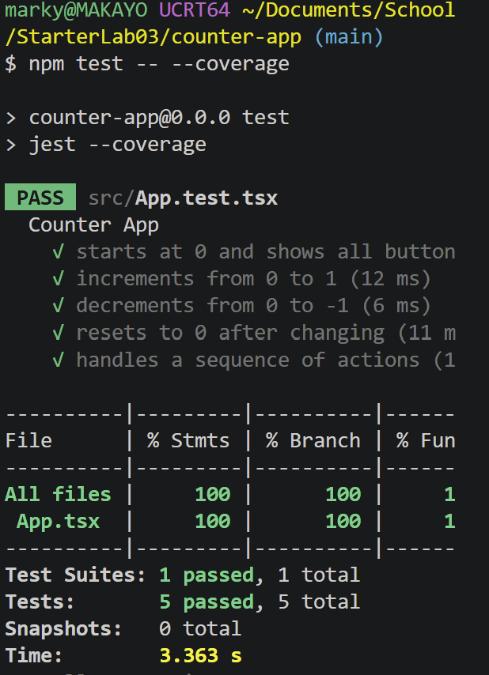

# Lab: Exploratory and White Box Testing

## Step 1: Exploratory Testing

### Testing Charter

Try the Increment, Decrement, and Reset buttons in different ways without
looking at the code.

### Results

| Action                          | Expected Result    | Actual Result     | Pass/Fail |
| ------------------------------- | ------------------ | ----------------- | --------- |
| Open the app                    | Count shows 0      | Count showed 0    | Pass      |
| Click Increment once            | Count becomes 1    | Count showed 1    | Pass      |
| Click Decrement once            | Count becomes -1   | Count showed -1   | Pass      |
| Increment twice, then Reset     | Count becomes 0    | Count showed 0    | Pass      |
| Increment twice, then Decrement | Count becomes 1    | Count showed 1    | Pass      |
| Click Increment 100 times       | Count reaches 100  | Count showed 100  | Pass      |
| Click Decrement 100 times       | Count reaches -100 | Count showed -100 | Pass      |

## Step 2: Source Code

The count starts at 0.

| Code                  | Button    |
| --------------------- | --------- |
| `setCount(count + 1)` | Increment |
| `setCount(count - 1)` | Decrement |
| `setCount(0)`         | Reset     |

There are no branches or loops. Each button always does one thing.

## Steps 3–7: Tests

All 5 tests in `src/App.test.tsx` passed.

## Step 8: Code Coverage

| Coverage Type | Percentage |
| ------------- | ---------- |
| Statements    | 100%       |
| Branches      | 100%       |
| Functions     | 100%       |
| Lines         | 100%       |

The tests used every part of the app. Nothing was missed. There are no
branches because the code never makes a choice. 100% only means every part
ran, not that it's correct.

## Step 9: Comparison

- **From exploring:** I clicked 100 times to see if the count had a limit. It didn't.
- **From the code:** Reset must be tested from a number other than 0.
- **What changed:** Seeing the code let me test each button on purpose instead of guessing.
- **Limits:** Exploring can't tell you if you've tried everything. Reading the code can't tell you what the app should do.

## AI Transparency

AI was used to help create portions of this file and to clean up its writing and formatting.
