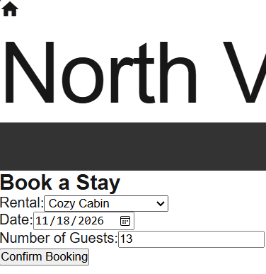
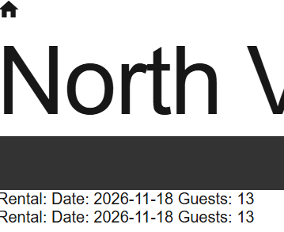

# North Vacation Booking — Defect Report

## 1. Classify the Findings

| Finding                   | Classification           | Explanation                                                                                   |
| ------------------------- | ------------------------ | --------------------------------------------------------------------------------------------- |
| F-01: More than 12 guests | Product defect           | The app accepted 13 guests even though the limit is 12.                                       |
| F-02: No checkout date    | Product defect           | There is only one date field, so users cannot enter or check a 1–31-night stay.               |
| F-03: No rental selected  | Product defect           | Bookings were saved with no rental listed and no error message.                               |
| F-04: Duplicate bookings  | Needs more investigation | Eight identical bookings appeared, but the requirements do not say if duplicates are allowed. |

## 2. Defect Report

| Field                | Details                                                               |
| -------------------- | --------------------------------------------------------------------- |
| Defect ID            | DEF-001                                                               |
| Title                | Booking allows more than 12 guests                                    |
| Date Reported        | November 16, 2026                                                     |
| Reporter             | Mark Yosinao                                                          |
| Application/Feature  | North Vacation Booking — Add Booking                                  |
| Test Environment     | Windows, Microsoft Edge, React/TypeScript; manual exploratory testing |
| Preconditions        | App and booking service are running; Add Booking page is open         |
| Severity             | High                                                                  |
| Priority             | High                                                                  |
| Status               | Open                                                                  |
| Related Requirements | R1: 1–12 guests; R6: Invalid information must show an error           |
| Supporting Evidence  | Screenshots below                                                     |

**Steps to reproduce:**

1. Open the Add Booking page.
2. Select a rental and enter a date.
3. Enter 13 guests.
4. Click **Confirm Booking**.
5. Open the Bookings page.

**Expected result:** The app should reject 13 guests and show an error.

**Actual result:** The app accepted the booking with 13 guests and showed no error.

### Screenshots

**Booking form with 13 guests**

**Booking accepted with 13 guests**

## 3. Severity and Priority

| Defect                   | Severity | Priority | Explanation                                                            |
| ------------------------ | -------- | -------- | ---------------------------------------------------------------------- |
| F-01: Guest limit        | High     | High     | Allows invalid bookings; should be corrected before release.           |
| F-02: Checkout date      | High     | High     | Cannot check the length of a stay; should be corrected before release. |
| F-03: Rental information | High     | High     | Allows bookings without a rental; should be corrected before release.  |

**F-04:** Still being investigated. No severity or priority assigned yet.

**Status:** The three defects are open. No fixes or retests have been done.

## AI Transparency

AI was used to clean up this file.
